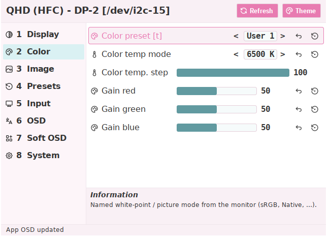
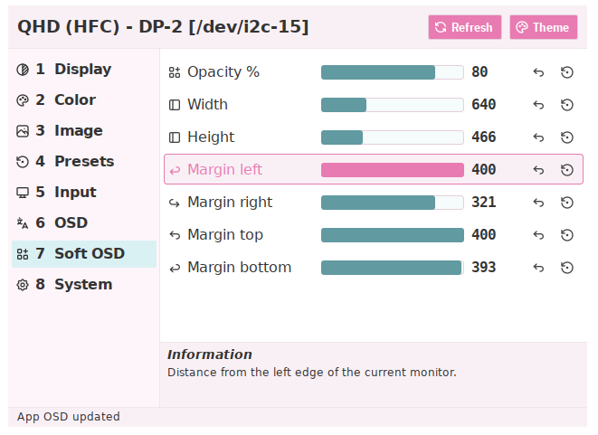
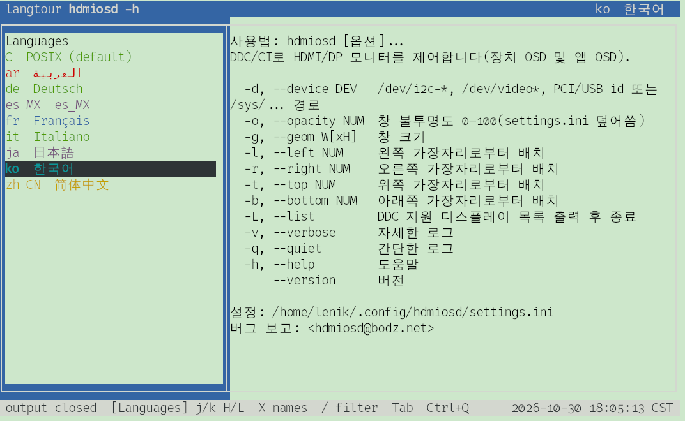

# hdmiosd

Linux 下用于 HDMI/DisplayPort 显示器的 DDC/CI 屏上控制器（C++ / wxWidgets）。

`hdmiosd` 通过 `/dev/i2c-*` 直接收发 DDC/CI（不调用 `ddcutil`），并以画布绘制
扁平 OSD；Tabler 图标经 bas-cpp assets 嵌入。

## 截图

设备 **Color** 页，底部 **Information** 显示当前高亮项说明：



**Soft OSD** — 不透明度、窗口尺寸与显示器边距：



本地化命令行帮助（`langfix hdmiosd -h`）：



## 设备菜单与 Soft OSD

| 菜单 | 作用 |
|------|------|
| **Display**、**Color**、**Image**、**Presets**、**Input**、**Audio**、**OSD**、**System** | 通过 VCP 控制**显示器**（空分类自动隐藏） |
| **Soft OSD** | 控制 **hdmiosd 窗口**：不透明度、尺寸、边距定位 |

侧栏顺序与上表一致。Soft OSD 与上次显示器、快捷键保存在：

```text
~/.config/hdmiosd/settings.ini
```

## 用法

```bash
hdmiosd [选项]
hdmiosd --list
hdmiosd -d /dev/i2c-15 -o 90 -r 24 -b 48
```

| 选项 | 含义 |
|------|------|
| `-d`/`--device` | `/dev/i2c-*`、DRM 名、PCI/USB id 或 `/sys/...` |
| `-o`/`--opacity` | 0–100（本次运行覆盖配置） |
| `-g`/`--geom` | 窗口尺寸 |
| `-l`/`-r`/`-t`/`-b` | 边距定位 |
| `-L`/`--list` | 列出 DDC 显示器 |

访问 I2C 通常需要加入 `i2c` 组（或以 root 运行）。

## 快捷键

| 按键 | 作用 |
|------|------|
| `1`–`N` | 选择侧栏分类 |
| `Tab` / `Shift+Tab` | 同页内下一个 / 上一个控件 |
| `←` `→` / `-` `+` | 调节数值 |
| `b` `c` … | 功能快捷键（见行标签） |
| `Ctrl+Z` / `Ctrl+R` | 撤销 / 复位当前控件 |
| `F5` | 刷新显示器与控件 |
| `F11` / `F12` | 上一个 / 下一个主题 |
| `[` / `]` | 上一台 / 下一台显示器 |
| 拖空白区域 | 移动 Soft OSD（近边边距实时更新） |
| `Esc` / `q` | 退出 |

默认快捷键在 `settings.ini` 的 `[shortcuts]` 段，可自行修改。

## 构建

```bash
sudo apt install meson ninja-build g++ pkg-config libbas-cpp-dev libbas-ui-dev \
  libwxgtk3.2-dev asciidoctor zip binutils
meson setup build
ninja -C build
meson test -C build
```

## 许可证

Copyright (C) 2026 Lenik <hdmiosd@bodz.net>

采用 **AGPL-3.0-or-later** 许可。完整文本见 `LICENSE`。
